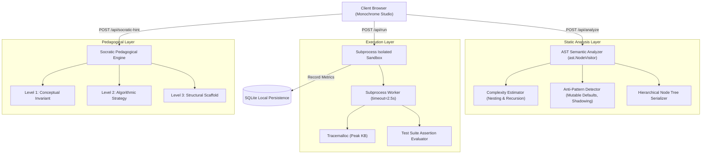

# TarkAI (तर्क) — Local-First Intelligent Code Auditor & Socratic AST Tutor

[](https://www.python.org/downloads/)
[](https://fastapi.tiangolo.com)
[](https://docs.pydantic.dev/)
[](LICENSE)
[]()

> **Engineered by Faris Ruknuddin ([@ZephyrusZorro](https://github.com/ZephyrusZorro))**  
> *A local-first pedagogical code evaluation engine that uses Abstract Syntax Tree (AST) static analysis, isolated subprocess sandboxing, and Socratic questioning to guide engineers toward deep mastery rather than copy-pasting AI code.*

---

## 🎯 Problem Statement & Motivation

Modern AI coding assistants (like Copilot and ChatGPT wrappers) suffer from a critical pedagogical flaw: **they dump full solutions directly onto the student**. This short-circuits the learning process, fosters cognitive passivity ("AI slop engineering"), and leaves candidates unprepared when asked to explain their mental models in live technical interviews.

Furthermore, naive online coding tutors execute untrusted student submissions without deep static analysis, failing to detect quadratic memory reallocations, hidden recursion blowups, and insidious anti-patterns (such as mutable default arguments or bare `except:` clauses).

**TarkAI (derived from the Sanskrit/Hindi word *Tark* (तर्क) meaning *Logic* or *Reasoning*)** solves this through a three-stage pipeline:
1. **Static AST Introspection:** Evaluates time complexity ($O(1) \rightarrow O(N) \rightarrow O(N^2) \rightarrow O(2^N)$), loop nesting depth, and anti-patterns *before* code execution.
2. **Process-Isolated Sandbox:** Runs test cases in an isolated subprocess with strict timeout guards (2.5s) and peak memory tracking via `tracemalloc`.
3. **Tiered Socratic Mentoring:** Formulates 3-tier pedagogical feedback (*Conceptual Invariant* $\rightarrow$ *Algorithmic Strategy* $\rightarrow$ *Structural Scaffold*) that guides the student to debug their own mental model without giving away the answer.

---

## 🏛️ System Architecture



---

## 🚀 Key Features

* **⚡ Zero-Token Static AST Analysis:** Inspects code complexity and anti-patterns purely on the CPU using Python's native `ast` module without costly or slow LLM API calls.
* **🛡️ Hardened Subprocess Sandbox:** Kills infinite loops (`while True: pass`) and deep recursion bombs cleanly within 2.5 seconds with exact diagnostics.
* **🧠 Socratic Hint Ladder:**
  * **Level 1 (Conceptual):** Points to the mathematical invariant or boundary edge case being violated.
  * **Level 2 (Algorithmic):** Suggests appropriate pointer movements, window bounds, or data structure choices.
  * **Level 3 (Scaffold):** Provides structural pseudocode blueprints while leaving implementation details to the student.
* **📚 Curated Engineering Curriculum:** Includes 5 core engineering tracks spanning Two Pointers, Sliding Windows, Kadane's Invariant, LIFO Stacks, and Memory-Efficient Streaming Generators.
* **💻 Cyber-Monochrome Developer Studio:** High-contrast dark UI with live line numbers, split-pane inspection tabs, and real-time AST hierarchy viewer.

---

## 🛠️ Quick Start

### Prerequisites
* Python 3.11+ installed.

### Installation
```bash
# Clone the repository
git clone https://github.com/ZephyrusZorro/tark-ai.git
cd tark-ai

# Install dependencies
pip install -r requirements.txt
```

### Running Locally
```bash
# Option A: Windows Batch Launcher
start.bat

# Option B: Direct Uvicorn Launch
python -m uvicorn backend.main:app --host 127.0.0.1 --port 8000 --reload
```
Open **`http://localhost:8000`** in your browser to access the TarkAI studio.

---

## 🧪 Test Suite Verification

TarkAI includes a complete unit and integration test suite covering AST parsing, complexity detection, subprocess sandboxing, timeout enforcement, and FastAPI routes:

```bash
pytest -v
```

**Results:**
```text
======================== 16 passed in 1.69s ========================
tests/test_api.py::test_api_health PASSED                       [ 6%]
tests/test_api.py::test_api_curriculum_list PASSED              [12%]
tests/test_api.py::test_api_analyze_code PASSED                 [18%]
tests/test_api.py::test_api_run_challenge_pass PASSED           [25%]
tests/test_api.py::test_api_socratic_hint PASSED                [31%]
tests/test_ast_analyzer.py::test_syntax_error_detection PASSED  [37%]
tests/test_ast_analyzer.py::test_linear_complexity_detection    [43%]
tests/test_ast_analyzer.py::test_quadratic_complexity           [50%]
tests/test_ast_analyzer.py::test_mutable_default_anti_pattern   [56%]
tests/test_ast_analyzer.py::test_bare_except_anti_pattern       [62%]
tests/test_ast_analyzer.py::test_builtin_shadowing PASSED       [68%]
tests/test_ast_analyzer.py::test_tree_recursion_detection       [75%]
tests/test_sandbox.py::test_sandbox_passing_execution PASSED    [81%]
tests/test_sandbox.py::test_sandbox_failing_assertion PASSED    [87%]
tests/test_sandbox.py::test_sandbox_runtime_exception PASSED    [93%]
tests/test_sandbox.py::test_sandbox_infinite_loop_timeout PASSED [100%]
```

---

## 📑 API Endpoints Specification

| Method | Endpoint | Description |
| :--- | :--- | :--- |
| `GET` | `/api/health` | Service health status, system version, and sandbox readiness. |
| `GET` | `/api/curriculum` | Returns challenge tracks with difficulty and solved state. |
| `GET` | `/api/challenge/{id}`| Retrieves challenge problem description, constraints, and starter code. |
| `POST` | `/api/analyze` | Evaluates Python AST, complexity score, and anti-patterns. |
| `POST` | `/api/run` | Executes sandboxed test runner with assertion checking. |
| `POST` | `/api/socratic-hint` | Returns tiered Socratic guidance based on failed assertions. |
| `GET` | `/api/stats` | Aggregates user attempts, solved count, and streak history. |

---

## ⚖️ License & Provenance

* **Author:** Faris Ruknuddin
* **License:** MIT License (Permissive open-source)
* **Status:** Fully functional, tested, and original implementation.
