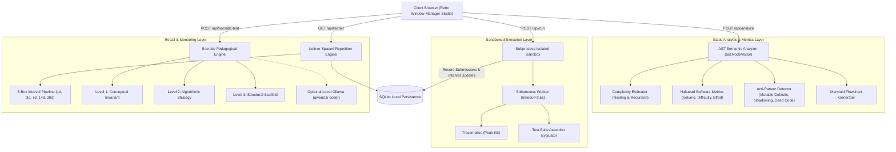

# TarkAI (तर्क) — Local-First Intelligent Code Auditor & Socratic AST Tutor

[](https://www.python.org/downloads/)
[](https://fastapi.tiangolo.com)
[](https://docs.pydantic.dev/)
[](LICENSE)
[]()

> **Authored by Faris Ruknuddin ([@ZephyrusZorro](https://github.com/ZephyrusZorro))**  
> *A local-first engineering evaluation engine combining Abstract Syntax Tree (AST) static analysis, Halstead software metrics, subprocess sandbox isolation, Leitner spaced repetition, and tiered Socratic mentoring in a retro tiling window-manager studio.*

---

## 🎯 Problem Statement & Motivation

Modern AI coding assistants (like Copilot and ChatGPT wrappers) suffer from a critical pedagogical flaw: **they dump full solutions directly onto the student**. This short-circuits the learning process, fosters cognitive passivity ("AI slop engineering"), and leaves candidates unprepared when asked to defend invariants in live technical interviews.

Furthermore, naive online coding tutors execute untrusted student submissions without deep static analysis, failing to detect quadratic memory reallocations, hidden recursion blowups, and insidious anti-patterns (such as mutable default arguments or bare `except:` clauses).

**TarkAI (derived from the Sanskrit/Hindi word *Tark* (तर्क) meaning *Logic* or *Reasoning*)** solves this through a multi-tier engineering studio:
1. **Static AST Semantic Introspection:** Evaluates time complexity ($O(1) \rightarrow O(N) \rightarrow O(N^2) \rightarrow O(2^N)$), loop nesting depth, and static anti-patterns *before* code execution.
2. **Halstead Software Engineering Metrics:** Computes programmatic Volume ($V$), Difficulty ($D$), Intellectual Effort ($E$), and Cognitive Complexity.
3. **Visual AST Execution Flowchart:** Dynamically renders an offline Mermaid flowchart graph tracing functions, loops, and branching paths.
4. **Process-Isolated Sandbox:** Runs test cases in an isolated subprocess with strict timeout guards (2.5s) and peak memory tracking via `tracemalloc`.
5. **Leitner 5-Box Spaced Repetition Drill Engine:** Tracks retrieval schedules across 1, 3, 7, 14, and 30-day review intervals to cement algorithmic intuition.
6. **Tiered Socratic Mentoring:** Formulates 3-tier pedagogical feedback (*Conceptual Invariant* $\rightarrow$ *Algorithmic Strategy* $\rightarrow$ *Structural Scaffold*) that guides the student to discover the invariant themselves.

---

## 🏛️ System Architecture



---

## 🖥️ Workspaces Overview

TarkAI provides 5 dedicated workspaces accessible via the top status bar or hotkeys (`Alt+1` through `Alt+5`):

| Workspace | Key | Description |
|---|---|---|
| **`[1: CODE_STUDIO]`** | `Alt+1` | 3-pane IDE with Curriculum Specs, Monospace Code Editor with line numbers, and Sandboxed Test Runner Console. |
| **`[2: AST_FLOWCHART]`** | `Alt+2` | Real-time interactive Mermaid flowchart diagram generated directly from the Python AST node visitor. |
| **`[3: HALSTEAD_COMPLEXITY]`** | `Alt+3` | Full software engineering telemetry: Big-O bounds, Cognitive Complexity gauge, Cyclomatic Complexity, Halstead table ($V, D, E$), and Anti-pattern alerts. |
| **`[4: LEITNER_DRILL]`** | `Alt+4` | 5-Box spaced repetition pipeline tracking retrieval strength, recall streaks, and "Due for Review Today" queue. |
| **`[5: SOCRATIC_COACH]`** | `Alt+5` | Full-screen interactive terminal dialogue for targeted invariant mentoring with quick-prompt chips. |

---

## 🚀 Key Features

* **⚡ Zero-Token Static AST Analysis:** Inspects code complexity and anti-patterns purely on the CPU using Python's native `ast` module without costly or slow LLM API calls.
* **📐 Halstead Software Metrics:** Computes distinct operators $\eta_1$, distinct operands $\eta_2$, total operators $N_1$, total operands $N_2$, vocabulary $\eta = \eta_1 + \eta_2$, volume $V = N \log_2 \eta$, difficulty $D = (\eta_1 / 2) \times (N_2 / \eta_2)$, and effort $E = D \times V$.
* **🛡️ Hardened Subprocess Sandbox:** Kills infinite loops (`while True: pass`) and deep recursion bombs cleanly within 2.5 seconds with exact diagnostics.
* **🧠 Socratic Hint Ladder:**
  * **Level 1 (Conceptual):** Points to the mathematical invariant or boundary edge case being violated.
  * **Level 2 (Algorithmic):** Suggests appropriate pointer movements, window bounds, or data structure choices.
  * **Level 3 (Scaffold):** Provides structural pseudocode blueprints while leaving implementation details to the student.
* **🔁 Leitner Spaced Repetition:** Implements the classic 5-box memory engine where passing challenges advance ($1 \rightarrow 3 \rightarrow 7 \rightarrow 14 \rightarrow 30$ days) and failures reset to Box 1 for immediate reinforcement.
* **📚 10 Curated Production Challenges:** 4 tracks spanning Two Pointers, Monotonic Stacks, Sliding Windows, Dynamic Programming, Streaming Generators, and Token Bucket Rate Limiters.
* **🎨 Retro Window-Manager Aesthetic:** Styled after Rao Muhammad Hamza's terminal-driven portfolio aesthetic with Space Mono & Space Grotesk fonts, `.dbar` status ticker, window titlebars with control dots (`● ● ●`), and toggleable CRT scanlines.

---

## 🛠️ Quick Start

### Prerequisites
* Python 3.11+ installed.

### Installation
```bash
# Clone the repository
git clone https://github.com/ZephyrusZorro/tark-ai.git
cd tark-ai

# Install dependencies
pip install -r requirements.txt
```

### Running Locally
```bash
# Option A: Windows Batch Launcher
start.bat

# Option B: Direct Python / Uvicorn Launch
python backend/main.py
```
Open **`http://localhost:8000`** in your browser to access the TarkAI studio.

---

## 🧪 Test Suite Verification

TarkAI includes 18 automated unit and integration tests:

```bash
python -m pytest tests -v
```

```text
tests/test_api.py::test_api_health PASSED
tests/test_api.py::test_api_curriculum_list PASSED
tests/test_api.py::test_api_analyze_code PASSED
tests/test_api.py::test_api_run_challenge_pass PASSED
tests/test_api.py::test_api_socratic_hint PASSED
tests/test_api.py::test_api_leitner_cards PASSED
tests/test_api.py::test_api_stats PASSED
tests/test_ast_analyzer.py::test_syntax_error_detection PASSED
tests/test_ast_analyzer.py::test_linear_complexity_detection PASSED
tests/test_ast_analyzer.py::test_quadratic_complexity_detection PASSED
tests/test_ast_analyzer.py::test_mutable_default_anti_pattern PASSED
tests/test_ast_analyzer.py::test_bare_except_anti_pattern PASSED
tests/test_ast_analyzer.py::test_builtin_shadowing PASSED
tests/test_ast_analyzer.py::test_tree_recursion_detection PASSED
tests/test_sandbox.py::test_sandbox_passing_execution PASSED
tests/test_sandbox.py::test_sandbox_failing_assertion PASSED
tests/test_sandbox.py::test_sandbox_runtime_exception PASSED
tests/test_sandbox.py::test_sandbox_infinite_loop_timeout PASSED

======================= 18 passed in 1.67s =======================
```

---

## 📄 License

MIT License. Designed and developed with pride by **Faris Ruknuddin**.
